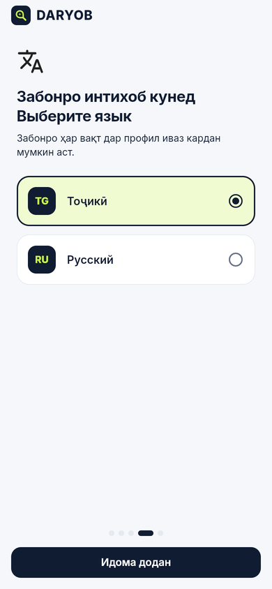
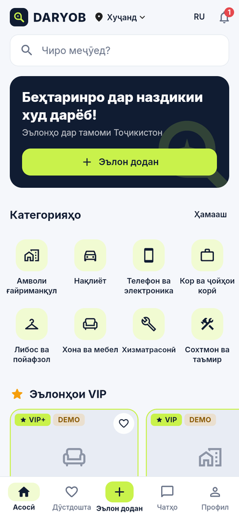
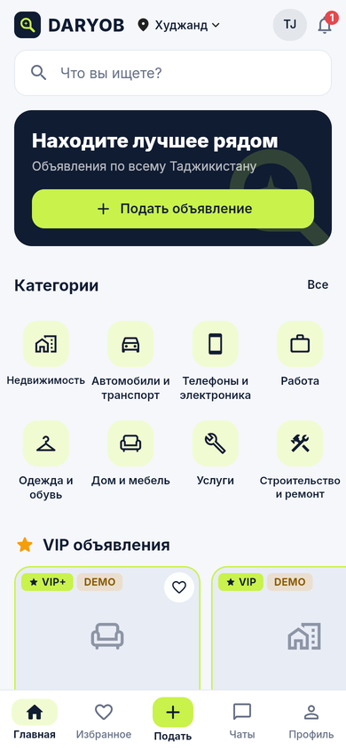
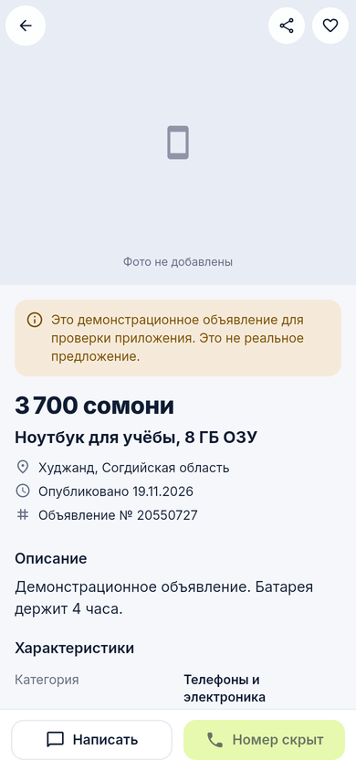
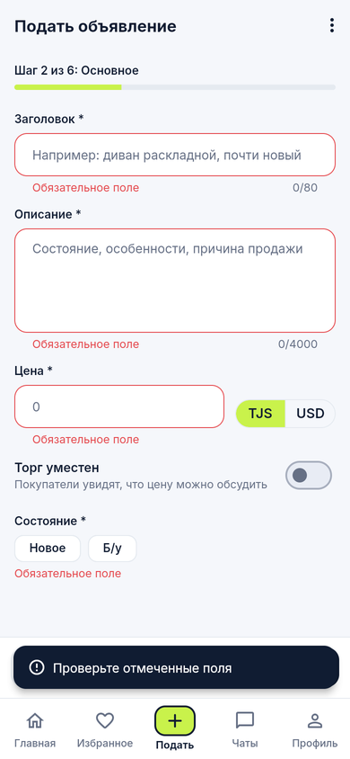
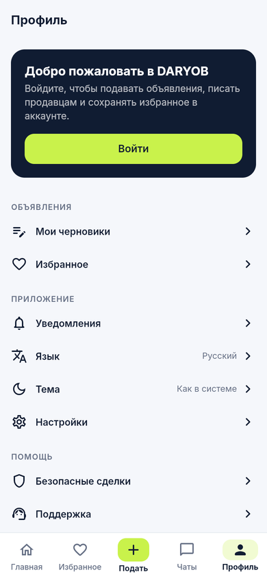
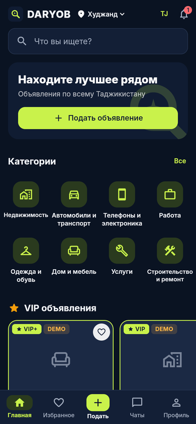

# DARYOB — площадка объявлений для Таджикистана

**Ҷустуҷӯ кун. Дарёб!** · Ищи. Находи. Покупай.

Flutter-приложение (Android в первую очередь, код готов к iOS). Это **Фаза 1**: каркас всего
приложения, дизайн-система, навигация, движок категорий и основные сценарии. Подробные формы
по каждой категории (авто, недвижимость, телефоны, работа…) добавляются отдельными модулями
в следующих фазах.

- Пакет: `tj.daryob.app` · Название: **DARYOB**
- Языки: таджикский (`tg`) и русский (`ru`), переключаются без перезапуска
- Валюта: TJS (сомонӣ / сомони), для части объявлений доступен USD
- Цвета бренда: `#101C32` (navy) и `#C9F24B` (lime)

| Заставка | Язык | Главная (тҷ) | Главная (ру) |
|---|---|---|---|
|  |  |  |  |
| **Объявление** | **Подача** | **Профиль** | **Тёмная тема** |
|  |  |  |  |

---

## Быстрый старт

Нужны Flutter **3.50** (stable, Dart 3.14) и Android SDK 36.

```bash
cd daryob
flutter pub get          # также генерирует локализацию из ARB
flutter run              # режим разработки с демо-данными
```

Проверки:

```bash
dart format .
flutter analyze
flutter test
```

## Сборка APK

```bash
flutter build apk --debug     # build/app/outputs/flutter-apk/app-debug.apk
flutter build apk --release   # build/app/outputs/flutter-apk/app-release.apk
```

### Подпись релиза

Ключи **никогда не хранятся в репозитории**. Чтобы подписать релиз своим ключом:

1. Создайте ключ (один раз):
   `keytool -genkey -v -keystore ~/daryob-release.jks -keyalg RSA -keysize 2048 -validity 10000 -alias daryob`
2. Создайте `android/key.properties` (он в `.gitignore`):
   ```properties
   storeFile=/полный/путь/daryob-release.jks
   storePassword=...
   keyAlias=daryob
   keyPassword=...
   ```
3. `flutter build apk --release` (или `flutter build appbundle` для Google Play).

Без `key.properties` release-сборка подписывается отладочным ключом — такой APK подходит для
установки на свой телефон, но **не для публикации**.

## Режимы работы

Режим задаётся при сборке через `--dart-define`:

| Переменная | Значения | По умолчанию |
|---|---|---|
| `DARYOB_ENV` | `development` / `production` | release-сборка — `production`, debug и тесты — `development` |
| `DARYOB_SERVER_URL`, `DARYOB_SERVER_KEY` | адрес и публичный ключ сервера | проект DARYOB в Supabase |
| `DARYOB_DEFAULT_LANG` | `tg` / `ru` — язык до выбора пользователем, если язык телефона не таджикский и не русский | `tg` |

```bash
flutter build apk --release                                         # настоящий сервер
flutter build apk --release --dart-define=DARYOB_ENV=development    # демо без сервера
```

**Разработка (`development`)** — работает без сервера:
- объявления, черновики, избранное, чаты, уведомления хранятся на телефоне (Hive);
- 16 демо-объявлений и 3 демо-продавца с пометкой **DEMO**;
- вход по номеру в демо-режиме: SMS **не отправляется**, код (`123456`) показывается на экране, номер **не** помечается подтверждённым;
- сообщения в чате сохраняются локально со статусом «не отправлено»;
- в «Инструментах разработчика» можно заново показать онбординг, пересоздать или удалить демо-данные, стереть всё;
- тестовое продвижение (VIP/ТОП) можно включить без оплаты — кнопка подписана «только DEV».

**Рабочий (`production`)** — настоящий сервер ([docs/BACKEND.md](docs/BACKEND.md)):
- объявления, фото, избранное и чат хранятся на сервере и видны всем пользователям;
- аккаунт привязан к устройству, номер телефона сохраняется без подтверждения кодом;
- оплата и push сообщают, что сервис не подключён, вместо имитации;
- демо-данных нет, тестового продвижения нет, экран разработчика закрыт.

## Что сделано и что ждёт интеграций

| Возможность | Состояние |
|---|---|
| Онбординг (4 экрана + выбор города), выбор языка | ✅ готово |
| Главная: поиск, баннер, категории, VIP, «Для вас», «Рядом», новые с подгрузкой | ✅ готово |
| 14 категорий и 115 подкатегорий из мастер-каталога, поля и фильтры по схемам | ✅ готово — статус справочников: [docs/CATALOG_STATUS.md](docs/CATALOG_STATUS.md) |
| Каталог: версии, офлайн-кэш, откат, синхронизация, импорт проверенных данных | ✅ готово (синхронизация ждёт `/v1/catalog`) |
| Проверенные модели и варианты памяти (официальные источники) | ⏳ не выполнено — источники недоступны из среды сборки |
| Карточка объявления: галерея, характеристики, продавец, звонок, чат, жалоба, похожие | ✅ готово |
| Подача объявления: категория → подкатегория → характеристики → … → предпросмотр, автосохранение, правка | ✅ готово |
| Мои объявления: активные / на проверке / черновики / проданные / архив | ✅ готово |
| Поиск: история, фильтры, сортировка, пагинация, состояние сохраняется | ✅ готово |
| Избранное: гость на телефоне, объединение при входе без дублей | ✅ готово |
| Профиль, настройки (язык, тема, уведомления, приватность), правила, безопасность | ✅ готово |
| Бизнес-аккаунт: профиль компании, статистика из реальных данных | ✅ основа |
| Продвижение, кошелёк, подписка: модели, экраны, тарифы из конфигурации | ✅ основа, **оплата не подключена** |
| Сервер: аккаунты, объявления с фото, поиск, избранное, чат в реальном времени, жалобы | ✅ работает на Supabase — [docs/BACKEND.md](docs/BACKEND.md) |
| Вход по коду в Telegram | ✅ Telegram Gateway; без Telegram — вход без подтверждения номера |
| Уведомления о сообщениях | ✅ пока приложение открыто или свёрнуто; ⏳ при закрытом — нужен Firebase |
| Геолокация | ✅ город по GPS, отметка объекта на карте |
| Оплата (местные платёжные системы) | ⏳ нужны договор и ключи провайдера (на сервере) |
| Проверка продавцов, модерация | ⏳ нужна админ-панель; жалобы уже сохраняются |
| Полный список районов и посёлков | ⏳ загрузить из официального источника |

Тексты «Правил» и «Политики конфиденциальности» — черновики и помечены так в приложении:
окончательные версии должен подготовить юрист.

Таджикские тексты стоит вычитать носителю языка перед публикацией.

## Структура

```
lib/
  app/            запуск, роутер, тема, локализация, конфигурация
  core/           ошибки, сеть (Dio), хранилище (Hive), безопасность, утилиты
  shared/         модели, провайдеры репозиториев, библиотека компонентов Daryob*
  features/
    onboarding/ home/ categories/ listings/ search/ favorites/
    authentication/ conversations/ notifications/ profile/
    sellers/ promotions/ settings/
```

Внутри фичи: `domain/` (модели и интерфейсы), `data/` (реализации), `application/`
(состояние, Riverpod), `presentation/` (экраны). Экраны работают только через интерфейсы
репозиториев; какая реализация используется, решает `shared/providers/repository_providers.dart`
по режиму сборки.

Технологии: Riverpod 3, go_router 18 (вкладки сохраняют состояние), Dio, Hive CE (локальная база),
flutter_secure_storage (сессия), cached_network_image, image_picker (системный выбор фото, сжатие
до 1600 px), url_launcher, share_plus. Модели написаны вручную (без кодогенерации), поэтому
сборка не требует `build_runner`.

## Каталог категорий

Категории, подкатегории, поля форм, условия `show_if`, фильтры и справочники брендов/моделей
берутся из `assets/catalog/daryob_catalog_master_2026.json` — экранов «под категорию» нет.

- `CatalogParser` превращает файл в `CategoryDefinition` + `CategorySchema` для каждой
  категории и подкатегории (id подкатегории: `vehicles.cars`, `real-estate.apartment_rent`).
- Мастер подачи, проверка, фильтры, карточка и поиск используют одну и ту же схему.
  Значения хранятся в `listing.attributes`; у объявления записаны `schemaId` и `schemaVersion`.
- Новое поле или подкатегория = правка JSON (и подписей вариантов в `catalog_labels.dart`;
  тест не даст выпустить вариант без русской и таджикской подписи).
- Новые модели и варианты — только пакетом импорта с источником и лицензией
  (`CatalogImporter`), через `/v1/catalog` или «Инструменты разработчика».

Что есть в справочниках и чего нет — в [docs/CATALOG_STATUS.md](docs/CATALOG_STATUS.md).

## Контракт API (для production)

`ApiListingRepository` ожидает такой REST API (JSON, `Authorization: Bearer <token>`):

| Метод | Путь | Ответ |
|---|---|---|
| GET | `/v1/listings?q=&category=&region=&price_min=&price_max=&attr[key]=&status=&sort=&page=&page_size=` | `{items: [Listing], page, has_more, total}` |
| GET | `/v1/listings/{id}` | `{listing}` |
| GET | `/v1/me/listings` | `{items}` |
| POST | `/v1/listings` | `{listing}` |
| PATCH | `/v1/listings/{id}` | `{listing}` |
| POST | `/v1/listings/{id}/status` `{status}` | `{listing}` |
| DELETE | `/v1/listings/{id}` | — |
| POST | `/v1/uploads` (multipart `file`) | `{url}` |
| POST | `/v1/reports` | — |
| GET | `/v1/categories/counts` | `{counts: {categoryId: n}}` |
| GET | `/v1/catalog/manifest` | `{version}` — версия каталога на сервере |
| GET | `/v1/catalog` | файл каталога в формате мастер-JSON |

Ошибки: `400/422 {errors: {field: code}}`, `401 {code: "session_expired"}`, `403`, `404`, `429`.
Права владельца, модерация, подтверждение продавца и активация платных услуг проверяются **на
сервере** — клиент ничего из этого не решает.

## Бренд

Знак: метка на карте, наклонённая на 45°, её острие продолжается ручкой лупы, внутри — искра
(поиск + место + «нашёл»). Рисуется кодом (`DaryobMark`), иконки собираются из SVG:

```bash
python3 tool/brand/make_svgs.py && node tool/brand/render_icons.js
```

Получаются адаптивная иконка Android (с монохромной версией), legacy-иконки, иконка заставки
Android 12+, а также `tool/brand/play_store_icon_512.png`. Заставка — navy с лаймовым знаком,
та же, что первый кадр Flutter, поэтому белой вспышки при запуске нет.
